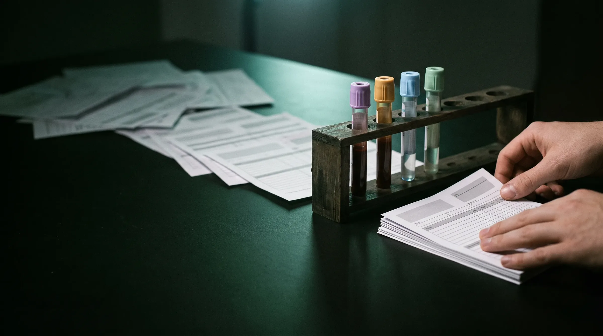
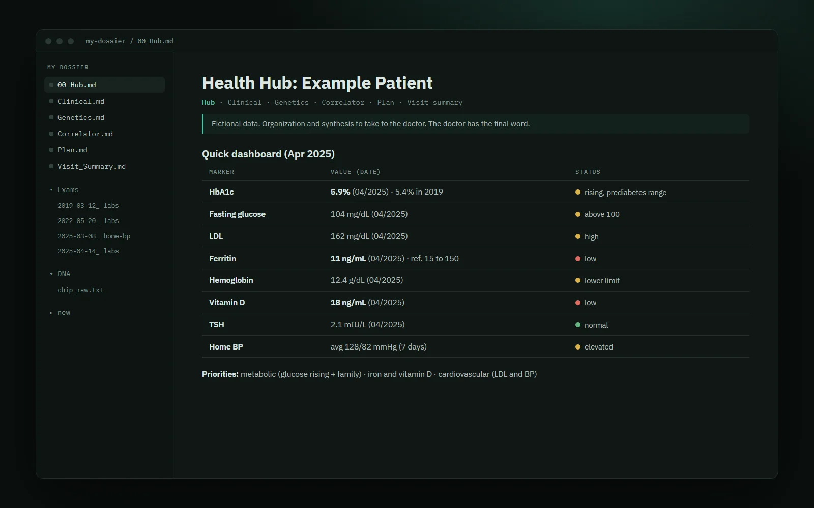
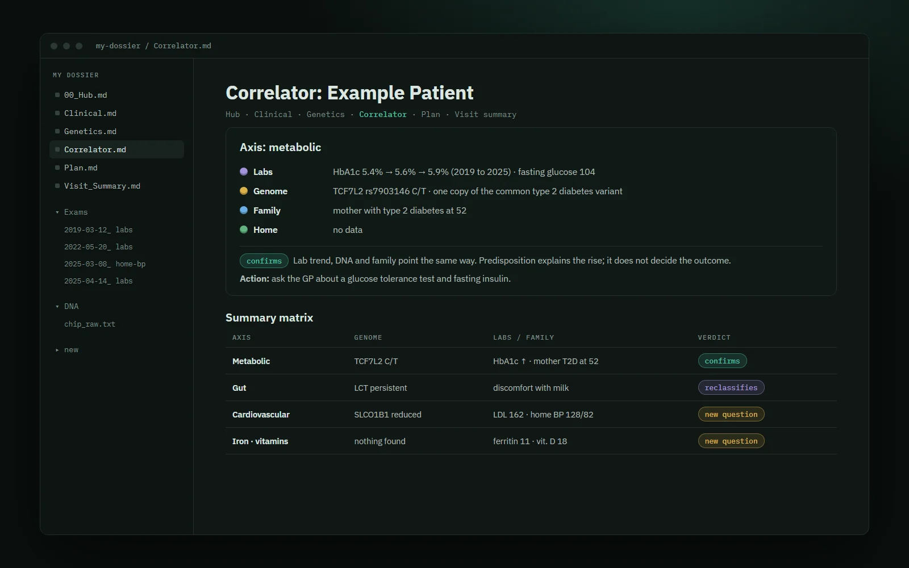
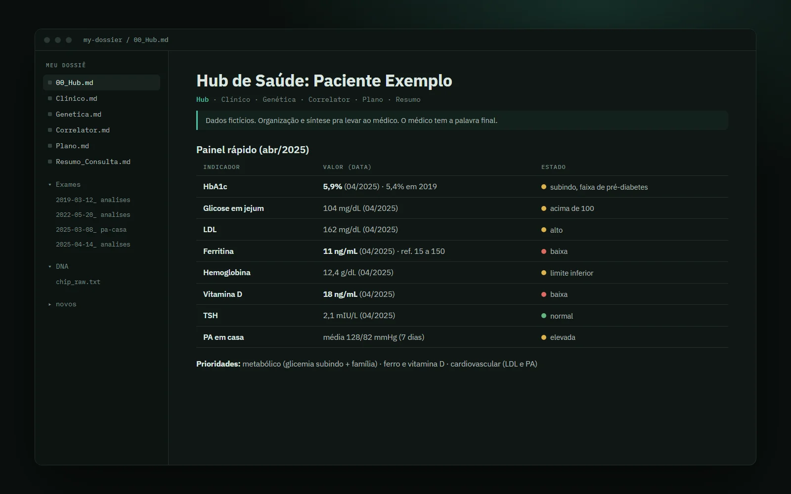
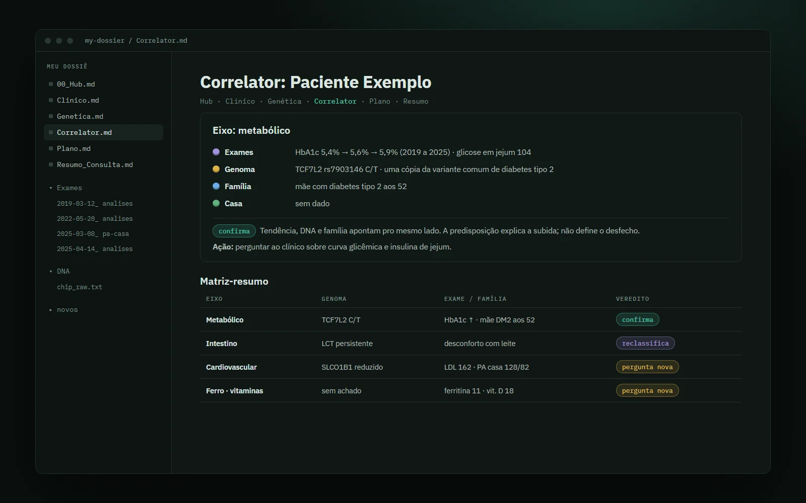

<p align="center">
  
</p>

<h1 align="center">Living Dossier · Dossiê Vivo</h1>

<p align="center">
  <b>English</b> · <a href="#português">Português</a><br>
  <a href="https://inhabitants.github.io/living-dossier/">Site</a> · <a href="DISCLAIMER.md">Disclaimer / Aviso</a> · <a href="llms.txt">llms.txt</a> · MIT
</p>

---

## English

A Claude Code plugin that organizes your medical life in one folder: lab results, genome, family history and what you measure at home, crossed in a single place. You walk into the appointment knowing what to ask.

> **Organization, synthesis and structuring of information.** Your doctor has the final word. Medication only with a prescription. Read the [DISCLAIMER](DISCLAIMER.md) before using it.

### Why I made this

There was a time when my first brain was failing. I had brain fog: my reasoning couldn't keep up, I kept losing the thread, and deciding anything about my own health became a weight I couldn't carry alone.

That's when AI became my second brain. Back then it was Gemini, a technology far below what we have today, and it still protected me. It organized what I couldn't organize, translated lab reports and conversations with doctors, and gave me back the bare minimum of control to make better decisions when my cognition couldn't keep up. It helped save my life.

Over time I gathered years of lab results, reports from different doctors in different countries, my family history and my genome. Getting to know myself at a biological level, with an agent translating all of it, gave me the chance to return to a life I thought was in the past. Today the one doing this work with me is Claude Opus 5.5, in the most responsible and detailed way I have ever seen.

None of this is medical advice. It is my motivation. Health varies a lot from person to person, and what worked for me is a starting point.

What I feel now is only gratitude. To Gemini, and to the whole context that made this possible: technology getting cheaper year after year, open source, the research and the published work of people I will never meet, feeding one dataset after another until it reached me. This plugin is my way of giving a little back. It is free and fully open, so that better and smarter people than me can make good use of it and adapt it to what they need.

Borderless

### What you get

<p>
  
  
</p>

<sub>The Hub and the Correlator of a fictional patient. Every value in these screens is made up.</sub>

| Document | Contents |
|---|---|
| `00_Hub.md` | Dashboard with the markers that matter most and links to the other documents |
| `Clinical.md` | Every result extracted, timeline by year, trends, active problems |
| `Genetics.md` | Only what is actionable: cardiovascular risk, pharmacogenomics, carrier status, ancestry |
| `Correlator.md` | By health axis, labs × genetics × family × home, with the tag of each crossing |
| `Plan.md` | What to do, in order: one blood draw, appointments with questions ready, how often to repeat each test |
| `Visit_Summary.md` | One page to bring to the doctor |

### The four layers and the crossing

| Layer | What it holds |
|---|---|
| 🟣 Labs | What has already happened in your body: reports, imaging, prescriptions, each with date, lab and reference range |
| 🟡 Genome | The predisposition: a consumer chip or a whole genome |
| 🔵 Family | The context: who had what, at what age |
| 🟢 Home | Your days, measured: blood pressure, heart rate, weight, sleep |

The **Correlator** crosses the four layers by health axis and tags every crossing as **confirms** (one layer explains another), **reclassifies** (one layer overturns a hypothesis) or **new question** (it goes to the appointment). The layer colors are the colors of blood collection tube caps.

### What it does

- Reads lab reports in PDF and photos of exams, and extracts every value with its date, lab and reference range.
- Builds the six documents above and keeps them updated with every new exam.
- Turns anything about medication into a question for your doctor.
- Files your documents in one folder per event, with standard names.
- With a whole genome, guides the analysis on your own machine with open bioinformatics tools.

### What it does not do

- Diagnosis.
- Starting, changing or stopping medication.
- Risk scores meant to replace a medical assessment.
- Emergencies. An acute symptom is a case for emergency services: **112** in Europe, **911** in the US, **192** (SAMU) in Brazil.

### Install

In Claude Code:

```
/plugin marketplace add inhabitants/living-dossier
/plugin install living-dossier@living-dossier
```

To try a local copy, replace `inhabitants/living-dossier` with the folder path. Recommended: Anthropic's official document skills, for reading PDFs.

```
/plugin marketplace add anthropics/skills
/plugin install document-skills@anthropic-agent-skills
```

Any other agent can follow the skills straight from the repo: point it at [`llms.txt`](llms.txt).

### How to use it

1. Create a folder for your health, **outside any git repository**. Put your lab reports, photos, prescriptions and DNA file in it. Inside it, create `new/` as your inbox.
2. Open Claude Code in that folder and ask: *"build my health dossier"*. The `dossier-build` skill takes inventory, asks what is missing and writes the documents.
3. New results: drop the PDF or photo into `new/` and say *"new exam arrived"*. The `dossier-update` skill renames, files and updates everything.
4. DNA: ask *"analyze my genome"*. The `dossier-genome` skill handles consumer chips (23andMe, MyHeritage, Ancestry) and whole genomes (VCF and CRAM).
5. Bring `Visit_Summary.md` to your next appointment.

The skills are written in English and answer in your language: ask in Portuguese, Spanish or anything else, and the dossier comes out in that language. A finished dossier for a fictional patient lives in [`examples/`](examples/), in English and Portuguese.

### Privacy

- Your data stays in your folder. The plugin has no server and collects nothing.
- Claude reads the files it opens for you through Anthropic's API. With a whole genome, the tools run on your computer and Claude reads only the results; the raw file stays on your disk.
- DNA is the most permanent data you have: you can change a password, not a genome. Avoid uploading your file to free interpretation websites.
- This repository's `.gitignore` blocks common lab and DNA formats, but the main protection is keeping your dossier folder out of git.

### Status and license

Published as is, by one person, for free. There is no support promise. Forks are welcome, and so are pull requests that follow [CONTRIBUTING](CONTRIBUTING.md). License: [MIT](LICENSE). Use it, copy it, adapt it.

From the bench at [Sapiens Sintéticos](https://www.sapiensinteticos.com). Not affiliated with Anthropic or Google. Claude is a trademark of Anthropic, PBC.

---

## Português

Um plugin pro Claude Code que organiza a sua vida médica numa pasta: exames, genoma, família e o que você mede em casa, cruzados num lugar só. Você chega na consulta sabendo o que perguntar.

> **Organização, síntese e estruturação de informação.** O médico tem a palavra final. Remédio só com receita. Leia o [AVISO](DISCLAIMER.md#português) antes de usar.

### Por que eu fiz isso

Teve uma fase em que o meu primeiro cérebro estava falhando. Eu tive névoa mental: o raciocínio não acompanhava, eu perdia o fio, e decidir qualquer coisa sobre a minha própria saúde virou um peso que eu não conseguia carregar sozinho.

Foi aí que a IA virou o meu segundo cérebro. Na época era o Gemini, uma tecnologia bem abaixo da de hoje, e mesmo assim ela me protegeu. Organizou o que eu não conseguia organizar, traduziu laudos e conversas com médicos, e me devolveu o mínimo de controle pra tomar decisões melhores quando a minha cognição não conseguia acompanhar. Ajudou a salvar a minha vida.

Com o tempo, juntei anos de exames, laudos de médicos diferentes em países diferentes, o histórico da minha família e o meu genoma. Me conhecer em nível biológico, com um agente traduzindo tudo isso, me deu a oportunidade de voltar pra uma vida que eu achava que já era passado. Hoje quem faz esse trabalho comigo é o Claude Opus 5.5, do jeito mais responsável e detalhado que eu já vi.

Nada disso é dica médica. É a minha motivação. Saúde varia muito de pessoa pra pessoa, e o que funcionou pra mim serve como ponto de partida.

O que eu sinto agora é só gratidão. Ao Gemini, e a todo o contexto que tornou isso possível: a tecnologia que ficou mais barata ano após ano, o open source, a pesquisa e o material publicado por gente que eu nunca vou conhecer, que alimentou base atrás de base até chegar em mim. Este plugin é a minha forma de devolver um pouco. Ele é de graça e totalmente livre, pra que pessoas melhores e mais inteligentes que eu façam bom uso e adaptem à necessidade delas.

Borderless

### O que sai

<p>
  
  
</p>

<sub>O Hub e o Correlator de uma paciente fictícia. Todo valor nessas telas é inventado.</sub>

| Documento | Conteúdo |
|---|---|
| `00_Hub.md` | Painel com os indicadores que mais importam e links pros outros documentos |
| Clínico | Cada exame extraído, linha do tempo por ano, tendências, problemas ativos |
| Genética | Só o acionável: risco cardiovascular, farmacogenômica, portador, ancestralidade |
| Correlator | Por eixo de saúde, exame × genética × família × casa, com o selo de cada cruzamento |
| Plano | O que fazer em ordem: coleta, consultas com perguntas prontas, cadência de exames |
| Resumo pra consulta | Uma página pra levar ao médico |

### As quatro camadas e o cruzamento

| Camada | O que guarda |
|---|---|
| 🟣 Exames | O que já aconteceu no seu corpo: laudos, imagens, receitas, cada um com data, laboratório e referência |
| 🟡 Genoma | A predisposição: chip de genotipagem ou genoma completo |
| 🔵 Família | O contexto: quem teve o quê e com que idade |
| 🟢 Casa | O dia a dia medido: pressão, frequência cardíaca, peso, sono |

O **Correlator** cruza as quatro camadas por eixo de saúde e marca cada cruzamento como **confirma** (uma camada explica a outra), **reclassifica** (uma camada derruba uma hipótese) ou **pergunta nova** (vai pra consulta). As cores das camadas são as das tampas dos tubos de coleta.

### O que ele faz

- Lê laudos em PDF e fotos de exame e extrai cada valor com data, laboratório e referência.
- Monta os seis documentos acima e mantém tudo atualizado a cada exame novo.
- Transforma tudo que envolve remédio em pergunta pro médico.
- Organiza os arquivos numa pasta por evento, com nome padronizado.
- Com genoma completo, guia a análise na sua máquina com ferramentas abertas de bioinformática.

### O que ele não faz

- Diagnóstico.
- Indicação, troca ou suspensão de remédio.
- Cálculo de risco que substitua avaliação médica.
- Atendimento de urgência. Sintoma agudo é caso de emergência: **112** na Europa, **192** (SAMU) no Brasil.

### Instalação

No Claude Code:

```
/plugin marketplace add inhabitants/living-dossier
/plugin install living-dossier@living-dossier
```

Pra testar uma cópia local, troque `inhabitants/living-dossier` pelo caminho da pasta. Recomendado: as skills oficiais de documento da Anthropic, pra ler PDF.

```
/plugin marketplace add anthropics/skills
/plugin install document-skills@anthropic-agent-skills
```

Qualquer outro agente segue as skills direto do repositório: aponte pro [`llms.txt`](llms.txt).

### Como usar

1. Crie uma pasta pra sua saúde, **fora de qualquer repositório git**. Junte laudos, fotos, receitas e o arquivo de DNA. Dentro dela, crie `novos/`, que vira a caixa de entrada.
2. Abra o Claude Code nessa pasta e peça: *"monta meu dossiê de saúde"*. A skill `dossier-build` faz o inventário, pergunta o que falta e escreve os documentos.
3. Exame novo: jogue o PDF ou a foto em `novos/` e peça *"chegou exame novo"*. A skill `dossier-update` renomeia, organiza e atualiza tudo.
4. DNA: peça *"analisa meu genoma"*. A skill `dossier-genome` trata chip (23andMe, MyHeritage, Ancestry) e genoma completo (VCF e CRAM).
5. Leve o resumo de uma página na próxima consulta.

As skills são escritas em inglês e respondem na sua língua: pede em português e o dossiê sai em português. Um dossiê pronto, de uma paciente fictícia, está em [`examples/`](examples/), em inglês e em português.

### Privacidade

- Os seus dados ficam na sua pasta. O plugin não tem servidor e não coleta nada.
- O Claude lê, pela API da Anthropic, os arquivos que abre pra você. Com genoma completo, as ferramentas rodam no seu computador e o Claude lê só os resultados; o arquivo bruto fica no disco.
- DNA é o dado mais permanente que você tem: senha a gente troca, genoma fica. Evite subir o seu arquivo em site de interpretação gratuita.
- O `.gitignore` deste repositório bloqueia os formatos comuns de exame e DNA, mas a proteção principal é a sua pasta de dossiê ficar fora do git.

### Situação e licença

Publicado como está, por uma pessoa, de graça. Não tem promessa de suporte. Fork é bem-vindo, e pull request também, seguindo o [CONTRIBUTING](CONTRIBUTING.md#português). Licença: [MIT](LICENSE). Use, copie, adapte.

Da bancada do [Sapiens Sintéticos](https://www.sapiensinteticos.com). Sem vínculo com a Anthropic nem com o Google. Claude é marca da Anthropic, PBC.
